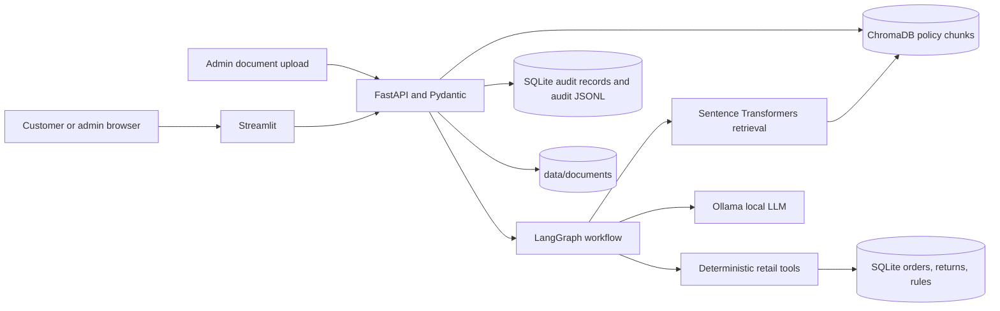

# Retail AI Support Agent

A synthetic-data retail support demo built with Streamlit, FastAPI, LangGraph, SQLite, ChromaDB, sentence-transformers, and Ollama.

## Architecture



Policy questions use retrieval-augmented generation (RAG); the answer includes source citations. Order, return, refund, and warranty facts are looked up or calculated by deterministic tools using SQLite. The LLM writes grounded wording; it is not the authority for customer records or arithmetic. The rule registry is in SQLite and each seeded rule names its source document and clause.

SQLite and ChromaDB are embedded stores, not separate Compose services. Compose mounts `./data` so the database, vector index, source files, and audit log persist on the host.

## Requirements and setup

### Local Python

Requires Python 3.11 and Ollama if using a real local model.

```bash
python3.11 -m venv .venv
source .venv/bin/activate
python -m pip install --upgrade pip
pip install -r requirements.txt
cp .env.example .env
```

Set a strong `ADMIN_PASSWORD` in `.env`. To use real LLM responses, install/start Ollama and fetch the configured model:

```bash
ollama pull llama3.1:8b
```

Generate and validate the included synthetic retail records, then seed the policy documents, ChromaDB, and SQLite rule registry:

```bash
python scripts/generate_synthetic_data.py
python scripts/validate_data.py --dir data/csv
python -m scripts.init_demo
python -m scripts.load_data --dir data/csv
```

The first policy indexing run may download the sentence-transformers embedding model. Start the API and UI in separate terminals from the project root:

```bash
uvicorn app.main:app --reload
streamlit run app/ui.py
```

Open <http://localhost:8501>. The admin page is at <http://localhost:8501/Admin>. If Ollama is unavailable, set `MOCK_LLM=true` in `.env` and restart the API; this is test mode, not a real language model.

### Docker Compose

Requires Docker Desktop (or Docker Engine with the Compose plugin). Ollama may run on the host; the Compose configuration points the API container at `host.docker.internal:11434`.

```bash
cp .env.example .env
# Set ADMIN_PASSWORD in .env; optionally set OLLAMA_MODEL or MOCK_LLM.
docker compose up --build
```

The API is available at <http://localhost:8000>, its OpenAPI UI at <http://localhost:8000/docs>, and Streamlit at <http://localhost:8501>. Compose starts the API and UI; SQLite is created on API startup and ChromaDB is created when the API accesses it. The named host folder `./data` is mounted into the containers for persistence.

To initialize the included policy corpus and demo records after Compose is running:

```bash
docker compose exec api python scripts/validate_data.py --dir data/csv
docker compose exec api python -m scripts.init_demo
docker compose exec api python -m scripts.load_data --dir data/csv
```

To stop the services, press Ctrl+C (foreground mode) or run `docker compose down`. Data in `./data` is retained.

## Data and registries

- `data/source_register.csv` is the Source Register export. It describes the fictional policy sources and matches the SQLite `source_register` columns.
- `data/rule_registry.csv` lists the seeded rules and their cited source sections. `python -m scripts.init_demo` verifies that each cited section exists in its policy text and writes these rules to the SQLite `rule_registry`.
- `data/documents/` contains the policy source files used by the app. `python -m scripts.init_demo` regenerates the three fictional demo policies and indexes them.
- `data/csv/` contains the generated synthetic customer, product, order, order-item, and return output. The included generator uses a fixed Python random seed; it does **not** call an LLM.
- `data/synthetic_data_prompt.txt` contains the prompt artifact for an approved LLM-generated alternative. If strict LLM-generated-data compliance is required, use an approved model, preserve its exact model/version and output, then validate the output.
- `docs/DATA_CARD.md` documents provenance, composition, intended use, and risks.

SQLite defaults to `data/retail.db`; ChromaDB defaults to `data/chroma/`; uploaded sources are stored under `data/documents/`. Override storage locations with `DATA_DIR`, `SQLITE_PATH`, and `CHROMA_DIR`. These paths are persisted in Compose through the `./data` mount.

## API examples

Health check:

```bash
curl http://localhost:8000/health
```

Ask a policy or customer-scoped order question:

```bash
curl -X POST http://localhost:8000/ask \
  -H 'Content-Type: application/json' \
  -H 'X-Customer-Id: C1001' \
  -d '{"question":"What is the return window for electronics?","as_of_date":"2026-10-01"}'
```

Check admin sign-in (the password is read from `.env` by the API):

```bash
curl http://localhost:8000/admin/session \
  -H 'X-Admin-Password: YOUR_ADMIN_PASSWORD'
```

Ingest one supported PDF, DOCX, TXT, or MD document:

```bash
curl -X POST http://localhost:8000/ingest \
  -H 'X-Admin-Password: YOUR_ADMIN_PASSWORD' \
  -F 'file=@policy.txt' \
  -F 'metadata_json={"doc_id":"RET-CIRCULAR-2026","authority_level":2,"effective_from":"2026-10-01","version":"1.0","category":"GENERAL","scope_tiers":"ALL"}'
```

Delete a registered source and its indexed chunks, file, and associated rules:

```bash
curl -X DELETE http://localhost:8000/sources/RET-CIRCULAR-2026 \
  -H 'X-Admin-Password: YOUR_ADMIN_PASSWORD'
```

## Tests

Run the full suite from the project root:

```bash
.venv/bin/python -m pytest -q
```

Run one test module:

```bash
.venv/bin/python -m pytest -q tests/test_retrieval.py
```

## Assumptions, limitations, and edge cases

- All customer/order data and policy examples are fictional. Do not load real customer data.
- `X-Customer-Id` and `X-Admin-Password` are demo controls, not production authentication. Production must derive customer identity from a trusted identity provider/gateway and use proper admin authorization.
- The app supports text-extractable PDF, DOCX, TXT, and Markdown. Scanned PDFs need OCR outside this project; image-only files may index no usable text.
- Document IDs must be unique in an ingestion batch. Re-ingestion replaces stale chunks for that ID. A document's file, source-register record, vector chunks, and linked rules are removed by the admin delete operation.
- The return-window day boundary is inclusive (day 30 is eligible for the electronics example); undelivered orders and items with an existing return request are not eligible for a new return. Refunds use net paid price, not list price. Refunds above the threshold require human approval; the demo does not issue refunds.
- Effective dates and authority determine policy applicability. Unresolved authoritative conflicts should be escalated rather than guessed. Date-only effective windows are evaluated using the request's `as_of_date` (or the current date when omitted).
- Customer chat history is held in Streamlit session state and is not durable across browser sessions or server restarts.
- Compose expects host Ollama at `host.docker.internal:11434` by default. Host-name routing differs by platform; configure `OLLAMA_BASE_URL` where needed. With no model available, the API reports degraded LLM health unless mock mode is enabled.
- This is a hackathon/demo implementation, not production transaction processing, security, compliance, or policy advice.

See [`docs/ARCHITECTURE.md`](docs/ARCHITECTURE.md), [`docs/DATA_CARD.md`](docs/DATA_CARD.md), [`docs/EVALUATION.md`](docs/EVALUATION.md), and [`docs/DEMO_SCRIPT.md`](docs/DEMO_SCRIPT.md) for more detail.
